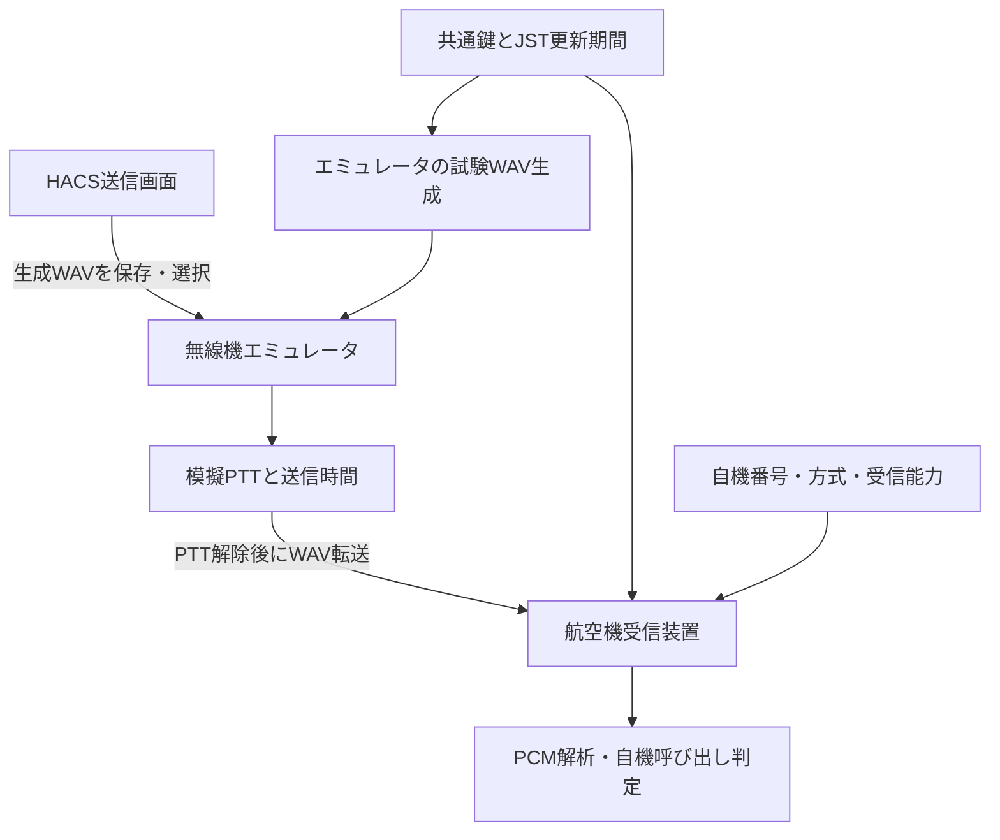

# 無線機・航空機受信装置エミュレータ

メーカー共通の模擬通信環境です。2つの独立したHTTPサービス／コンテナで動作します。SELCAL 16/32のPCM音声を転送し、航空機側が自機コードと照合します。国際電気・日立国際・R&Sなどの個別ICD、電気特性、RF伝搬は再現しません。



## 起動

Windows / macOS / LinuxのDocker Composeで、リポジトリのルートから実行します。

```sh
docker compose -f compose.yaml -f compose.emulators.yaml up -d --build
```

| 画面 | URL |
|---|---|
| HACS送信 | http://localhost:8787 |
| 既存WAV受信試験 | http://localhost:8788 |
| 無線機エミュレータ | http://localhost:8789 |
| 航空機受信装置エミュレータ | http://localhost:8790 |

1. 航空機画面で自機番号（初期値5501）、自機コード方式、受信能力を設定します。受信設定コード・期間・鍵識別子が表示されます。
2. 無線機画面で呼び出し先番号・方式を指定して試験WAVを生成します。またはHACS送信画面から保存したWAVを選択します。
3. 「無線機から航空機へ模擬送信」を押します。前待ち0.3秒、WAV時間、後待ち0.2秒の間、模擬PTTがONになります。
4. PTT解除後に音声ファイルを転送します。航空機画面に自機呼び出し／他機呼び出し／未検出が表示されます。無線機画面にも模擬受信結果が返ります。このHTTP応答は実際のSELCALのRF応答を表しません。

自機と異なる機番号なら「他機」、無音WAVなら「未検出」を確認できます。32音の自機コードには32音の受信能力が必要です。設定・直近結果・履歴はメモリ内にあり、再起動で初期化されます。音声再生はブラウザの操作で行い、自動音声警報はありません。

## 共通鍵・自動更新モード

既存の[自動更新・鍵管理手順](automatic-rotation-and-management.md)に従って管理トークンを準備したうえで実行します。

```sh
docker compose -f compose.yaml -f compose.emulators.yaml -f compose.rotation.yaml -f compose.emulators.rotation.yaml up -d --build
```

HACSのみが共通鍵DBを書き込み、両エミュレータは読み取り専用で共有します。日／週／月のJST 00:00更新・緊急鍵変更を既存マッピング処理から取得します。鍵DBの準備前には状態取得が一時的に失敗しますが、準備後の再取得で回復します。

鍵ありモードでは期間・鍵識別子付きのHACS WAVが必要です。古い期間・鍵のWAVは拒否します。画面上の過去結果は「旧期間・旧鍵の結果」と表示します。WAV付加情報は署名・暗号化された情報ではなく、模擬試験用の整合性確認に使う情報です。空中線のトーンに含まれる情報ではありません。

## インターフェース

| サービス | メソッド・パス | 入力／用途 |
|---|---|---|
| 共通 | GET /api/status | 状態、模擬PTT、現在設定、直近結果、最大40イベント |
| 無線機 | POST /api/generate | JSON: tail_number, mode → 試験WAV |
| 無線機 | POST /api/transmit | WAVバイナリ → 航空機へ転送 |
| 航空機 | POST /api/config | JSON: tail_number, mode, receive_mode |
| 航空機 | POST /api/input | WAVバイナリ → 音声解析結果 |

WAVは2 MB以下、モノラル16bit PCM、8〜96 kHz、0.3〜10秒。並行する送信・解析・設定更新は409で拒否します。転送先は起動環境変数`HACS_AIRCRAFT_URL`で固定し、Webリクエストで変更できません。転送失敗時もPTTはOFFです。HTTP転送はバッファ方式で、リアルタイムの音声ストリームではありません。

Docker外では`HACS_EMULATOR_ROLE=radio` / `aircraft`、`PORT=8789` / `8790`を設定し、各プロセスで`python emulator_server.py`を実行できます。環境変数の設定記法はOSのシェルに従ってください。

## 検証範囲

`python -m unittest test_emulators -v`で、独立HTTPサーバ間の16/32音一致・他機判定、無音、共通鍵整合性、旧鍵拒否、処理中409、入力不正、PTT解除と転送障害を検証します。実機・RF・Docker実起動による試験とは別です。
