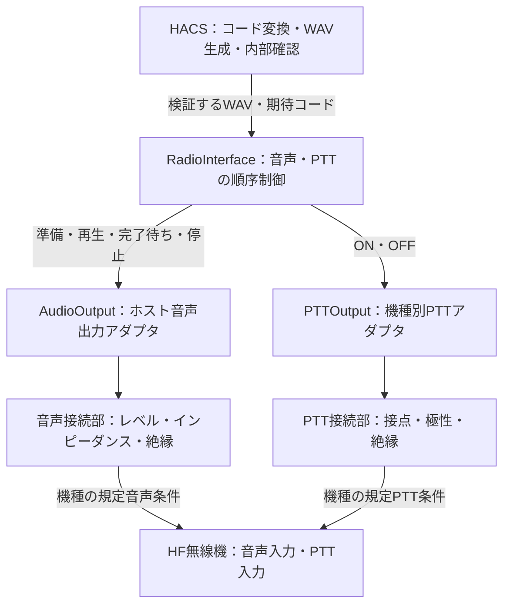

# HF無線機の汎用音声入力・PTTテンプレート

メーカーを限定しないHF無線機へ接続するための、接続プロファイルとソフトウェアのひな形です。音声入力は**無線機側の送信用音声入力**を指し、HACS側は無線機に接続したホスト端末から音声を出力する設計です。

現時点で実装した実行バックエンドはドライランだけです。音声デバイス・接点・CAT等の実機ドライバは差し替え用ひな形であり、実装・接続試験は未実施です。

## 接続テンプレート



図のホスト音声出力・電気接続部は将来の実機接続範囲です。既存Web画面のブラウザ再生からPTTを操作する構成にはしていません。実出力を実装する際は、無線機に接続した端末上で音声とPTTを同じ制御処理から扱います。

| 記入項目 | テンプレートの値 | 機種別に確定する内容 |
|---|---|---|
| メーカー・型番・端子 | `null` | 接続する実機と取扱説明書・接続図 |
| 音声信号・音声リターンのピン | `null` | 信号線、リターン、シールドの結線 |
| 音声入力方式 | `null` | 平衡／不平衡 |
| 入力インピーダンス・入力レベル | `null` | Ω、規定Vrms、許容最大Vrms |
| 音声帯域 | `null` | 選択した16音／32音の成分を通す帯域 |
| ホスト音声出力デバイス | `null` | 実際に無線機へ接続した出力デバイス |
| 音声絶縁・PTT絶縁 | `null` | 機種・接続条件に応じた方式 |
| PTT方式・極性・ピン | `unconfigured` / `null` | 接点、論理入力、CAT等と有効状態 |
| PTT開放電圧・電流 | `null` | 接続部の電気条件 |
| 独立したPTT監視・解除機構 | `null` | ソフトウェア停止時にも解除できる仕組み |
| 前待ち・後待ち | 0.3秒 / 0.2秒 | ドライラン用仮値。実機の立ち上がり・音声出力遅延から調整 |
| PTT上限 | 5秒 | ドライラン用仮値。信号長と前後待ち時間より長く設定 |

`radio_templates/generic.json` をコピーして機種別プロファイルを作ります。`null`を推測で埋めず、機種の仕様・測定結果で確定します。プロファイルの電気条件は記録欄であり、値を書くだけでは自動校正・電気条件の適合確認・実送信は行いません。

## ソフトウェアテンプレート

| ファイル・クラス | 役割 |
|---|---|
| `radio_interface.py` / `AudioOutput` | 音声デバイスの準備、再生開始、完了待ち、停止の共通契約 |
| `radio_interface.py` / `PTTOutput` | PTT有効化・解除の共通契約 |
| `radio_interface.py` / `RadioInterface` | PCM一致確認、排他制御、前後待ち、時間予算、例外時の解除処理 |
| `radio_templates/driver_template.py` | 実機ドライバの差し替え用ひな形。未実装操作は明示的に例外を返す |
| `radio_templates/generic.json` | 接続・電気条件・待ち時間の設定ひな形 |
| `radio_dry_run.py` | 現在の機番号変換と生成音声を使い、実出力せず処理順序を確認するCLI |

順序は「音声をPCM解析して一致確認 → 音声デバイス準備 → 鍵・期間確認 → PTT ON → 前待ち → 鍵・期間再確認 → 再生開始 → 音声デバイスの完了待ち → 後待ち → 音声停止 → PTT OFF」です。

音声長と前後待ち時間がPTT上限に収まらなければ、PTTを有効化する前に拒否します。デバイス準備・PTT有効化・再生等の例外時にも、音声停止とPTT解除を試みます。音声停止に失敗してもPTT解除を呼びます。完了した場合も相手の呼び出し成功は保証せず、`receiver_acknowledged`は`false`です。

排他は1つの`RadioInterface`インスタンス内です。実機実装では同じ物理無線機を1つのインスタンスで管理し、別プロセスからの重複操作も防ぐ必要があります。

時間上限はソフトウェアの時間予算チェックです。音声ドライバは`wait_complete(timeout_seconds)`の期限を守り、停止・PTT操作も有限時間で完了させる契約です。テンプレートはハングしたドライバ呼出しを強制中断できず、OSや電気回路によるPTT上限保証も提供しません。

## ドライランの実行

Pythonで実行します。従来16音・SELCAL 32の両方を指定できます。

```bash
python3 radio_dry_run.py --profile radio_templates/generic.json --tail 5501 --mode selcal16
python3 radio_dry_run.py --profile radio_templates/generic.json --tail 5501 --mode selcal32
```

起動済み送信コンテナでも確認できます。

```bash
docker compose exec hacs python radio_dry_run.py --tail 5501 --mode selcal32
```

現在の鍵・期間設定に従ってコードを計算し、WAVを生成してPCM一致を確認します。出力JSONの`dry_run: true`と`physical_output: false`が実音声・実PTTを操作していないことを示します。待ち時間も実際には待たず、イベント列として記録します。`sequence_completed`は模擬手順の完了であって実送信完了ではありません。`backend`を`dry_run`以外にすると実行を拒否します。

## 適用範囲

この追加で汎用の接続・処理テンプレートを作成しました。実機端子・電気条件の確定、音声・PTTドライバ実装、Web画面との実送信連携、RF・実受信装置での検証は引き続き未実施です。既存のWAV生成・再生・内部ループバック機能はそのまま利用できます。

関連: [システム構成図](system-architecture.md)、[二方式対応仕様](dual-mode-spec.md)。
