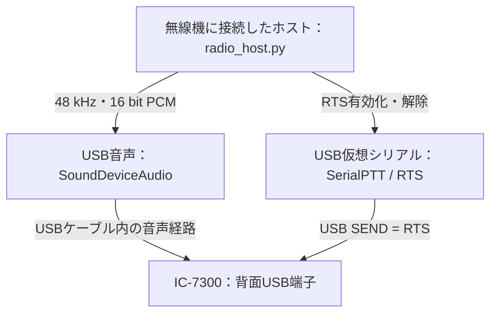

# サンプル：アイコム IC-7300 のUSB音声・RTS接続

メーカー公開資料を確認し、既存の `SoundDeviceAudio` と `SerialPTT` を利用するサンプルを作成しました。対象は **IC-7300（MK2ではない）** です。アマチュア無線機の接続例であり、航空用通信装置としての適合性や実機でのSELCAL送信成功を示すものではありません。

設定ファイル: [icom-ic7300-usb.json](../../radio_templates/icom-ic7300-usb.json)。ホストの音声デバイス・シリアルポートは環境ごとに異なるため、初期値を`null`としています。無編集では実出力できません。

## 接続構成



同じUSBケーブルで音声と制御線を扱います。外部のUSB-RS232変換器をSEND端子へ接続する例ではありません。このサンプルではUSB仮想シリアルのRTSで送受信を切り替え、CI-Vのデータコマンドは送信しません。

## 公開資料からの確認とサンプルへの適用

参照した英語版Full Manualでは、次の項目を確認しました。印刷ページ番号とPDFページ番号（1始まり）を併記します。

| 項目 | 公開資料で確認した内容 | サンプルでの扱い | 参照箇所 |
|---|---|---|---|
| USB音声入力 | USB入力の変調レベルを調整する設定がある | USB音声出力を使用。レベルは実測で調整 | 12-9 / PDF 125ページ |
| データモード時の音声源 | `DATA MOD`でUSBを選択できる | データモードを有効にし、`DATA MOD = USB` | 12-10 / PDF 126ページ |
| USB SEND | USB接続のDTRまたはRTSで送受信を制御できる | `USB SEND = RTS` | 12-11 / PDF 127ページ |
| CW/RTTYのUSBキーイング | SENDと同じ制御線の重複使用に制限がある | CW/RTTYのUSBキーイングをOFFにする | 12-11 / PDF 127ページ |
| USB接続時の抑止タイマー | ONでは接続・ポート確立等の後に数秒の抑止がある | ONを保持し、前待ちに暫定6秒を確保 | 12-11 / PDF 127ページ |
| USBシリアル機能 | CI-VまたはRTTY復号出力を選択できる | `USB Serial Function = CI-V` | 12-11 / PDF 127ページ |

`manual_radio_settings`は無線機の手動設定を記録した欄であり、HACSがその設定を自動適用するものではありません。USB-Dは本サンプルの運用モード選択です。送受信周波数・RF出力・帯域・USB MOD Levelは、無線機側で試験条件に合わせて設定します。

## HACS側の値

| 設定 | サンプル値 | 根拠・状態 |
|---|---|---|
| `backend` | `host_audio_serial` | 既存ホストドライバを使用 |
| `host_output_device` | `null` | 実際のUSB音声デバイスIDを設定 |
| `channels` | `2` | HACSが同じPCMを左右へ複製する選択。対応デバイスで確認 |
| `serial_port` | `null` | IC-7300のUSB仮想シリアルポートを設定 |
| `control_line` | `rts` | 公開説明書のUSB SEND選択に対応 |
| `active_high` | `true` | pySerialの論理有効状態を使うサンプル。実機の送受信切替は未確認 |
| `lead_seconds` | `6.0` | HACSの暫定値。メーカー保証の抑止時間ではない |
| `tail_seconds` | `0.2` | HACSの暫定値 |
| `max_ptt_seconds` | `12.0` | 前待ち6秒＋WAV2.2秒＋後待ち0.2秒より長い時間予算 |

汎用ドライバは送信操作ごとに仮想シリアルポートを開きます。したがって、USB接続時だけでなくポートを開くたびの抑止の影響を確認します。メーカー資料は抑止時間を固定秒数では示していないため、6秒で十分とは保証しません。実機で送信開始と第1音の開始を測定し、必要に応じて前待ちと上限を調整してください。HACSはUSB SENDが無線機側で有効になったことを読み取る機能を持ちません。

## 設定と確認手順

1. 使用するIC-7300とファームウェアに対応する取扱説明書・USBドライバ手順を確認し、USB音声デバイスと仮想シリアルポートを認識させます。OS別の実機動作はこの開発環境では未検証です。
2. 無線機のデータモードを有効にし、上記の手動設定を行います。抑止タイマーはONを維持します。
3. ホストに追加依存を導入し、音声出力デバイスを確認します。

```bash
python -m pip install -r requirements-radio.txt
python radio_host.py --list-audio
```

4. サンプルJSONをコピーして、`audio_input.host_output_device`と`ptt.serial_port`を実際の値で埋めます。数値IDを使用する場合はOSの再起動・USB再接続後にも対応する機器を確認してください。

```bash
python radio_host.py --profile radio_templates/my-ic7300.json --tail 5501 --mode selcal32 --level 0.1
```

このコマンドは設定確認だけを行い、音声・PTTを操作しません。JSONの`physical_output`が`false`であることを確認できます。

5. システム内のドライランと、送信画面の内部ループバックでコード・PCMの一致を確認します。

```bash
python radio_dry_run.py --tail 5501 --mode selcal32 --level 0.1
```

6. 実機試験ではRFの試験系（ダミーロード等）で送信開始・音声レベル・各成分・音長を確認した上で、実出力を実行します。RF出力・周波数はこのCLIから変更しません。

```bash
python radio_host.py --profile radio_templates/my-ic7300.json --tail 5501 --mode selcal32 --level 0.1 --execute
```

`--level 0.1`はデジタル振幅の試験開始例で、無線機の規定電圧・RF出力・適正変調度を意味しません。16音の確認では`--mode selcal16`に変更します。鍵付き運用の場合は、ホストCLIの鍵・周期設定を送信部と一致させてください。

## 確認できた範囲と未確認項目

公開資料でUSB変調入力とRTSによるSEND制御の機能を確認しました。サンプルの構文、未設定デバイスの拒否、仮のホスト値を与えた設定確認モードをソフトウェア上で検証しています。

IC-7300実機、OSのUSB認識、RTS極性、抑止時間、送信音声の振幅・帯域・歪み、既存SELCALデコーダの呼び出しは未検証です。メーカー資料の確認だけで実機互換性確認済みとはしません。Ethernet・1553・CATによる操作はこの1機種サンプルには含めません。

## 参照資料

- アイコム日本公式 IC-7300/7300M/7300S取扱説明書案内: https://www.icom.co.jp/support/manual/2405/
- Icom UK公開Full Manual、確認資料 `IC-7300_ENG_FM_12a.pdf`: https://icomuk.co.uk/files/icom/PDF/advancedManuals/IC-7300_ENG_FM_12a.pdf
- 日本公式USBドライバ案内: https://www.icom.co.jp/support/drivers/3611/

確認日: 2026-10-12（JST）。取扱説明書・メーカーの図・ドライバ自体はHACSに同梱せず、参照リンクを記載しています。
