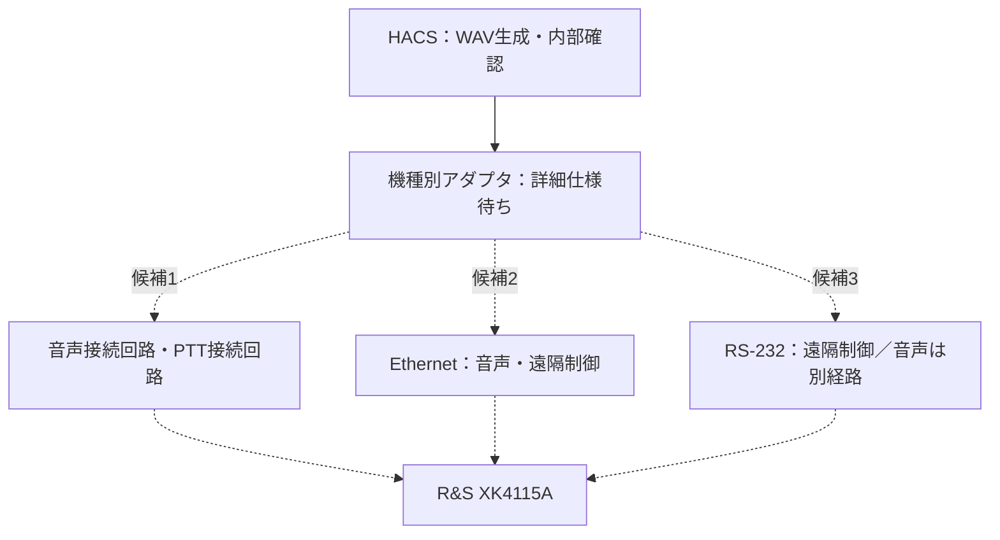

# サンプル：R&S XK4115A / M3SR Series4100

ローデ・シュワルツのメーカー公開資料を確認し、HF無線機 **R&S XK4115A（M3SR Series4100）** の接続検討用サンプルを追加しました。これはIC-7300のUSB接続例とは別のサンプルです。

設定ファイル: [rs-xk4115a-dry-run.json](../../radio_templates/rs-xk4115a-dry-run.json)。実行バックエンドは`dry_run`です。実音声・実PTT・Ethernet・RS-232操作は行いません。

## 確認した公開資料

| 資料 | 確認箇所 | 確認した内容 |
|---|---|---|
| M3SR Series4100公式製品ページ [1] | 利用可能なモデル | XK4115Aが掲載されている |
| Series4100公式カタログ v06.00 [2] | 7ページ（PDF 7ページ） | シリーズのIP音声・遠隔制御、音声ライン・RS-232の接続、VoIP/SIPの説明 |
| 同カタログ [2] | 22ページ（PDF 22ページ） | XK4115A/Dの構成と、Audio/PTT、RS-232 remote control、LANの接続表示 |

公開カタログの接続表示はインターフェースの存在を確認する根拠です。PTT端子の極性・電圧、音声入力レベル、具体的なPTTコマンドまで確定する根拠にはしていません。適用するソフトウェア・オプション・実機構成も個別に確認します。

## HACSとの接続候補



破線は未実装の接続候補です。3経路を同時接続する指定ではありません。

| 候補 | HACS側で作る部分 | 確定が必要な情報 |
|---|---|---|
| アナログ音声＋PTT | ホスト音声ドライバと機種適合の音声・PTT回路 | Audio/PTT端子のピン、入力レベル、インピーダンス、PTT電気条件、送信開始時間 |
| Ethernet音声＋制御 | 接続セッション・音声転送・PTTを扱う機種別アダプタ | 制御プロトコル・ポート、認証、音声形式、PTT要求・解除・状態応答、適用オプション |
| RS-232制御＋別音声経路 | 機種固有のコマンド・応答処理 | 通信条件、フレーム形式、PTT命令、状態照会、音声入力の選択方法 |
| MIL-STD-1553 | 対応を確認できた場合のバスアダプタ | 本機の1553対応有無、必要装置、ICD、BC/RT構成 |

確認した資料では、本機のMIL-STD-1553接続を確認できませんでした。非対応とも断定せず、設定ファイルの`supported`は`null`としています。

RS-232端子があることを、RTS/DTRを直接PTTとして使える根拠にはしません。既存の`SerialPTT`を本機へそのまま適用せず、制御線かデータコマンドかをICDで確定します。Ethernetについても、IcomのUSB音声やHACSのWAVアップロードAPIをそのまま使えるとは扱いません。

## サンプル設定の内容

- `radio`にメーカー、型番、公開資料で確認したAudio/PTT接続を記載します。
- `transport_candidates`にアナログ・Ethernet・RS-232・1553の候補と根拠、未確定パラメータを記録します。
- 電圧・端子・極性・IPアドレス・ポート・コマンド等の未確定値は`null`です。これらは調査・設計用の欄であり、現在のランナーは実通信に使用しません。
- 前待ち0.3秒、後待ち0.2秒、PTT上限5秒はHACSのドライラン既定値です。R&Sの装置仕様値ではありません。

## 実出力しない確認

```bash
python3 radio_dry_run.py --profile radio_templates/rs-xk4115a-dry-run.json --tail 5501 --mode selcal16
python3 radio_dry_run.py --profile radio_templates/rs-xk4115a-dry-run.json --tail 5501 --mode selcal32
```

Windowsでは環境に応じて`python3`を`python`に読み替えます。現在のHACSの鍵・周期設定でコードを計算し、PCM内部確認と音声・PTTの模擬順序を実行します。JSONに`dry_run: true`と`physical_output: false`を出力します。

同じファイルを実出力用`radio_host.py`へ渡すと、`host_audio_serial`用ではないため拒否します。`backend`だけを書き換えても未確定のデバイス・PTT設定で拒否されます。機種適合の実送信アダプタとして完成したサンプルではありません。

## 実機接続へ進めるための資料

対象機のInterface Control Document、設置・接続マニュアル、Remote Control Protocol、音声インターフェース仕様と、実機の型番・ソフトウェア版・オプション構成を確認します。これにより端子・電気条件・コマンド・音声形式を確定し、機種別ドライバを実装します。

音声がVoIP等を経由する場合は、音声帯域・符号化・音声処理・バッファが2音の周波数、振幅比、信号長、無音間隔に与える影響を測定する試験を設けます。公開資料でIP音声に対応していることだけでは、HACSのSELCAL信号がそのまま保持される保証にはしません。

## 確認範囲

資料上の接続候補とサンプル構文、両方式のドライランを確認しています。R&S実機・ネットワーク接続・シリアル接続・PTT操作・RF出力・実受信装置の呼び出しは未検証です。

## 参照資料

[1] R&S日本公式 M3SR Series4100製品ページ: https://www.rohde-schwarz.com/jp/products/aerospace-defense-security/software-defined-radios-options/m3sr-series4100-software-defined-radios_63493-9903.html

[2] メーカー公開カタログ `M3SR-Series4100_bro_en_5213-9557-12_v0600.pdf`: https://scdn.rohde-schwarz.com/ur/pws/dl_downloads/dl_common_library/dl_brochures_and_datasheets/pdf_1/M3SR-Series4100_bro_en_5213-9557-12_v0600.pdf

[3] メーカー公式資料一覧: https://www.rohde-schwarz.com/jp/brochure-datasheet/m3srseries4100/

確認日: 2026-10-12（JST）。メーカー資料・写真・図そのものは再配布せず、接続関係はHACS独自の図で記載しています。
