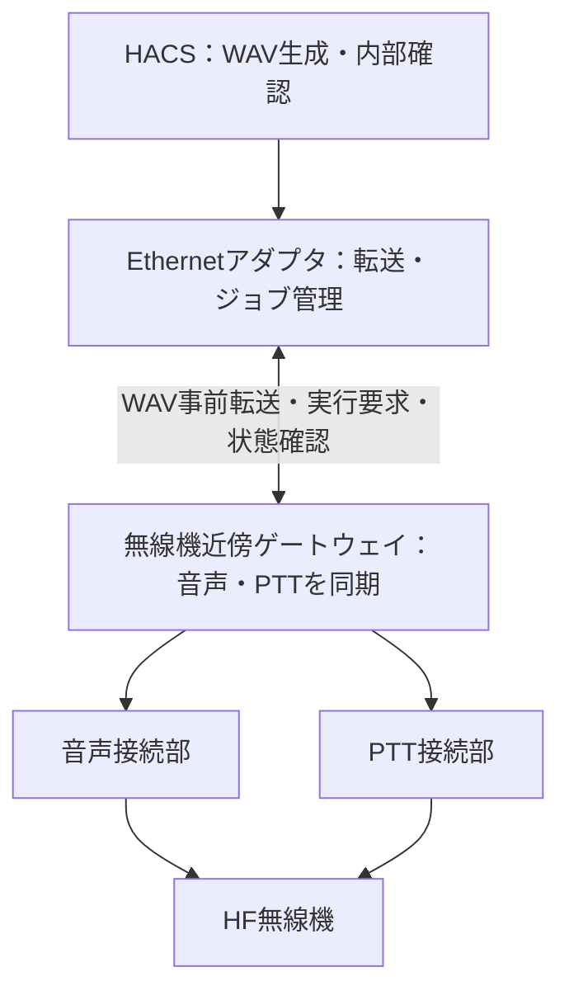

# Ethernet・MIL-STD-1553・シリアル接続方式の検討

本書は追加接続方式の設計検討です。現時点でEthernet・1553・シリアルデータコマンドの実送信ドライバは実装していません。シリアルRTS/DTRによるPTTドライバは実装済みですが実機未検証です。既存の音声・PTT共通インターフェースを利用し、方式ごとのアダプタに展開します。

## 比較

| 方式 | 音声経路 | PTT・制御経路 | 必要な情報 | 現状 |
|---|---|---|---|---|
| ローカル音声＋USBシリアル | ホスト音声出力→接続回路→無線機 | RTS/DTR→機種適合回路 | 端子・レベル・極性・立ち上がり | 汎用ドライバ実装、実機未検証 |
| シリアルデータ制御（RS-232/422/485） | 原則は別音声経路、または装置内部生成 | CAT等の機器固有コマンド | 電気規格・通信条件・コマンド・応答 | 設計検討 |
| Ethernet対応無線機に直接接続 | 無線機が指定する音声プロトコル | 無線機の制御API | 音声形式、API、時刻同期、遅延、認証 | 機種別仕様待ち |
| Ethernet音声/PTTゲートウェイ | WAV事前転送→ゲートウェイで再生→無線機 | ゲートウェイのジョブ制御 | API・再生デバイス・接続回路 | 汎用化の優先候補、設計案 |
| MIL-STD-1553による制御 | 原則は別音声経路、または装置内信号生成 | 1553の機器固有制御メッセージ | 適用規格版・ICD・BC/RT構成・スケジュール | 設計検討 |
| Ethernet→1553ゲートウェイ | 別音声経路または対象装置の内部生成 | ベンダーAPI→1553メッセージ | ゲートウェイSDKと対象機器ICD | 設計検討 |

**Ethernetの物理接続があることだけでは、音声やPTTの操作仕様は決まりません。** 制御API、音声転送方式、セッション管理は接続機器の仕様に合わせます。ネットワーク音声方式を使用する場合も、音声転送とPTT制御は個別に確認します。

## Ethernetの推奨構成案

メーカーを問わず展開するため、音声・PTTの順序制御を無線機近傍のゲートウェイへ置く案を優先します。HACSで生成したWAVを事前転送し、ゲートウェイ側で全体を検証・保持してから、現地の音声とPTTを同期します。通信の瞬断がそのまま音声の欠落になることを避ける狙いです。

以下はHACS向けに提案する条件であり、既存無線機の共通規格ではありません。

- WAVのハッシュ、期待コード、呼び出し相手先、方式、鍵識別子、期間、有効期限をジョブに付ける。
- ゲートウェイでPCM内部確認を行い、同じ装置内でPTTと音声を操作する。
- 実行要求に一意のジョブIDを使い、同じIDの再送は同じ結果を返し、二重送信しない。
- 応答が失われた場合は状態照会し、送信完了が不明なジョブを自動再送しない。
- PTT上限はゲートウェイ側で管理する。クライアント側の通信タイムアウトだけに依存しない。
- 制御セッションの認証・暗号化とアクセス制御は、コード変換用共通鍵とは別の仕組みとする。
- ゲートウェイの時刻同期・期間切替時の扱いを定義し、有効期限後のジョブを拒否する。

直接接続する無線機がネットワーク音声しか受け付けない場合は、その機種が要求する音声転送・バッファ・PTT同期方式に置き換えます。新しい汎用ゲートウェイAPIを既存無線機が実装しているとは扱いません。

## MIL-STD-1553の位置付け

MIL-STD-1553はコマンド／応答方式のデータバスです。BC（Bus Controller）が転送を制御し、RT（Remote Terminal）が指定されたメッセージに応答します。BM（Bus Monitor）は監視用であり、監視機能だけではPTT操作を行えません。規格はバスとメッセージの基本構造を定めますが、特定の無線機の「PTT ON」や「呼び出しコード設定」の意味は対象機器のICD（インターフェース管理文書）で確認する必要があります。[1]

| 確認項目 | 決める内容 |
|---|---|
| 規格版・実装条件 | 対象バスに適用する版、接続・結合条件 |
| バス役割 | HACS側ゲートウェイがBCかRTか、既存BCとの関係 |
| アドレス・転送定義 | RTアドレス、サブアドレス、送受信方向、ワード数 |
| ICD | PTT、送信許可、状態、音声源選択、コード設定のデータ定義 |
| データ表現 | ワード順序、ビット位置、値の単位・範囲 |
| タイミング | BCの通信周期、応答期限、送信開始待ち・解除の遅延 |
| 冗長性 | A/Bバスの使用方針、切替条件、再試行時の二重操作防止 |
| 故障・解除 | 通信断・状態不明時の送信抑止、現地側のPTT解除・上限 |
| 接続機材・SDK | インターフェースカードまたはゲートウェイ、OS・SDKの対応 |

既存BCが管理しているバスに別のBCを無条件で追加する設計にはしません。RTとして接続する場合は、BCがHACS側の要求を取得・転送するメッセージとスケジュールが必要です。

音声経路はまず「1553で制御、音声は別経路」または「1553でコード等を渡し、対象装置が信号生成」に分けて検討します。後者は対象装置に信号生成機能とICDがある場合に限ります。PCM音声を1553へそのまま連続転送する方式は既定案にせず、必要なら帯域・フレーミング・バス負荷・遅延を個別評価します。

Ethernet経由で1553を扱う市販機材は存在します。Altaの例ではBC/RT/BM機能とIP/UDPによる接続が提供されますが、PC側IPスタックの遅延に関する制約も記載されています。[2] これは構成の実現例であり、HACSでの採用・互換確認・製品推薦を意味しません。

## シリアルデータ接続の検討

RTS/DTRの制御線操作と、シリアル通信でコマンドを送る操作は別の方式です。実装済みの`SerialPTT`は前者だけを扱い、CATコマンドや音声データをシリアル送信するものではありません。

| 方式 | 主な用途 | HACSのアダプタ設計 |
|---|---|---|
| USBシリアルのRTS/DTR | 外部回路を介したPTT入力操作 | 実装済みの`SerialPTT`。データ通信なし |
| RS-232 | 無線機・制御装置とのコマンド通信 | 機種のCAT等に合わせた送受信・応答判定 |
| RS-422 | 機器が対応する差動通信 | 適合する変換器・結線・機種固有プロトコル |
| RS-485 | 機器が対応する差動・複数局通信等 | 半二重／全二重、送受信方向、アドレス管理を機器仕様で定義 |

RS-232/422/485は電気的な接続方式です。それだけではPTT・周波数設定・音声転送のコマンド形式は決まりません。USBシリアル変換器の電気規格と、接続する機器の規格を一致させます。TTL UARTとRS-232等の信号を同一と扱いません。

### 機種別に確定する項目

- 物理規格、コネクタ、送受信・リターン・シールドのピン、絶縁、RS-485の場合は終端とバイアスの条件。
- ボーレート、データビット、パリティ、ストップビット、フロー制御。
- フレームの区切り、文字コード／バイナリ、アドレス、チェックサム、エンディアン。
- PTT ON/OFF、送信許可、状態照会、音声入力選択等のコマンドと応答。
- 応答期限、操作間隔、最大送信時間、異常状態からの解除方法。
- 応答消失時の状態照会と再試行条件。PTT操作を無条件に再送しない。

同じポートでデータ通信とRTS/DTR制御を併用する場合は、1つの接続管理アダプタに集約します。ハードウェアフロー制御がRTS/DTRを使用する場合は、PTTとの競合を確認します。pySerialの`timeout`と`write_timeout`でデータ入出力の期限を設定できますが、OS・USB機器の停止時まで含む電気的解除保証ではありません。[3]

RS-485の方向制御はOS・変換器によって対応が異なります。pySerialのRS-485 APIを使用する場合も、採用する変換器とOSで送受信切替時間を測定して確認します。[3]

音声はまずホスト音声出力等の別経路とし、シリアルはPTT・装置制御に使う案を優先します。装置がコード指定による内部信号生成に対応する場合は、その機能を利用する別アダプタを検討します。メーカー共通の架空コマンドは定義せず、ICDまたは機器マニュアルから具体化します。

## 実装の進め方

1. 接続無線機または制御装置のICDから、音声経路とPTT経路を選択する。
2. EthernetではAPIとジョブ状態、1553ではBC/RT構成と制御メッセージ、シリアルでは通信条件とコマンド・応答を定義する。
3. 模擬ゲートウェイ・模擬バスでタイムアウト、二重操作防止、解除、冗長切替を検証する。
4. 機種別アダプタを追加し、音声・PTTを同じ現地制御処理へ結び付ける。

Windows/Mac/Linux共通のHACS本体からEthernetゲートウェイを利用する構成なら、ベンダーSDKや1553カードのOS依存をゲートウェイへ集約できます。直接カードを接続する構成では、そのカード・SDKの対応OSに制約されます。

## 参照資料

[1] NASA公開 MIL-STD-1553B: https://nepp.nasa.gov/docuploads/43745C0A-323E-4346-A434F4342178CD0E/MIL-STD-1553.pdf （基礎構造の参照。実機の適用版は別途確認）

[2] Alta ENET-1553公式資料: https://www.altadt.com/product/enet-1553/

[3] pySerial API（タイムアウト、RTS/DTR、RS-485）: https://pyserial.readthedocs.io/en/latest/pyserial_api.html

関連: [汎用音声入力・PTTテンプレート](generic-radio-interface.md)、[システム構成図](system-architecture.md)。
