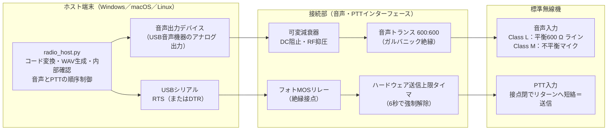

# HACS標準アナログ無線機インターフェース仕様 v1

仕様識別子：`HACS-STD-ANALOG-v1`
作成日：2026-10-14（日本時間）
状態：設計基準（実機未検証）

## 1. 目的と位置付け

対象無線機は未確定です。本仕様では、**アナログ音声入力とPTT入力を備えたHF無線機**を「標準無線機」として定め、HACSのホスト側ソフトウェア、接続部（音声・PTTインターフェース装置）、試験手順をこの基準で先行して整備します。

本仕様は3つの要素で構成されます。

| 区分 | 内容 | 本書での扱い |
|---|---|---|
| A. HACSの出力 | 生成音声、ホスト音声出力、PTT制御の順序 | HACSが満たす値。ソフトウェア試験で確認済みの範囲を含む |
| B. 接続部 | 音声レベル調整・絶縁、PTT接点・絶縁、ハードウェア送信上限 | 製作・調達する装置の要求仕様 |
| C. 標準無線機 | 音声入力・PTT入力・送信系の性能 | 無線機が標準適合とみなされるための条件 |

本書の数値は**特定機種の資料値ではありません**。実機が確定したら、その資料値と実測値を機種別プロファイルに記録し、C項の条件を満たすかどうかで「標準適合」を判定します。満たさない項目は機種別の差分として扱います。この方針は[必要項目一覧](radio-interface-requirements.md)の「未確認値を汎用値で補完しない」原則と両立させるためのものです。標準プロファイルは`"values_basis": "standard_reference"`で基準値であることを示し、実機の値と混同しないようにします。

## 2. 構成



接続部は無線機側からはマイクとPTTスイッチに見える装置です。ホストとはUSBのみで接続し、無線機側とは音声・PTTの両方で電気的に絶縁します。

既存Web画面のブラウザ再生では、PTTは自動化されません。標準構成での実送信は、無線機に接続したホストの`radio_host.py --execute`で行います（[汎用音声・PTT](generic-radio-interface.md)）。Webからの実送信連携は[引き継ぎ書](developer-handover.md)の優先3〜4で設計・実装します。

## 3. 入力区分

標準無線機の音声入力は、次の2区分のどちらかとします。

| 項目 | Class L（推奨） | Class M |
|---|---|---|
| 想定する入力 | 業務用の平衡ライン入力、外部音声・データ用入力 | マイク端子、アクセサリ端子の不平衡入力 |
| 方式 | 平衡 | 不平衡 |
| 入力インピーダンス（基準値） | 600 Ω | 600 Ω以上（接続部は200 Ω以上の負荷を駆動できること） |
| 標準入力レベル | 0.775 Vrms（0 dBu） | 0.030 Vrms（−28.2 dBu） |
| 最大入力レベル | 1.55 Vrms（+6 dBu） | 0.100 Vrms（−17.8 dBu） |
| プロファイル | `radio_templates/standard-analog-line.json` | `radio_templates/standard-analog-mic.json` |

**標準入力レベルは、HACSの呼び出し信号（2音合成）のRMS電圧で表します。** 2音合成信号のピークはRMSの2倍（波高率6.02 dB）です。最大入力レベルは正弦波のRMS値として扱い、2音ピーク（標準入力×2）が最大入力の正弦波ピーク（最大入力×√2）を超えないことを条件とします。Class Lの基準値では、2音ピーク1.55 Vに対して許容ピークが2.19 Vで、約3 dBの余裕があります。

Class Mは機種ごとのばらつきが大きいため、Class Lの入力がある機種では必ずClass Lを使います。マイク端子に直流バイアス（エレクトレットマイク用電源）がある機種では、接続部の直流阻止を必須とします。

## 4. A. HACSの出力（ソフトウェア側の保証範囲）

| 項目 | 値 | 根拠・確認方法 |
|---|---|---|
| 信号形式 | 2音同時1.0秒 → 無音0.2秒 → 2音同時1.0秒 | `selcal.py`、単体試験 |
| PCM | 48 kHz・16 bit・モノラル（2チャンネル出力時は左右同一） | `radio_drivers.py` |
| トーン周波数 | 従来16音 312.6〜1479.1 Hz、SELCAL 32 312.6〜1557.8 Hz | 固定周波数表（[二方式対応仕様](dual-mode-spec.md)） |
| 2音の振幅差 | 0 dB（デジタル上で同一振幅） | 単体試験 |
| 出力レベル`L`（0.01〜0.9） | 各トーン振幅 `L/2` FS、合成RMS `L/2` FS、ピーク `L` FS | `radio_calibration.py figures` |
| RMS（フルスケール正弦波基準） | `20·log10(L) − 3.01` dBFS。L=0.5で−9.03 dBFS | 同上 |
| 送信前確認 | 生成PCMを受信処理で解析し、期待コード1件と一致しなければPTTを操作しない | `RadioInterface.run` |
| PTT順序 | 音声デバイス準備 → 鍵・期間確認 → PTT ON → 前待ち → 再確認 → 再生 → 再生完了 → 後待ち → PTT OFF | 同上 |
| 送信時間上限（ソフトウェア） | 前待ち＋2.2秒＋後待ち＜PTT上限。既定 0.3＋2.2＋0.2＜5.0秒 | `Timing`、`radio_settings.py` |
| 音声デバイス選択 | 明示したIDまたは完全一致の名前のみ。既定デバイスへ自動で切り替えない | `SoundDeviceAudio` |

標準の運用出力レベルは**0.5**とし、上下それぞれ約6 dBのデジタル調整幅を残します。目標電圧に合わせる主な手段は接続部の減衰器とし、デジタル側のレベルは微調整に使います（7章）。

## 5. B. 接続部の要求仕様

### 5.1 音声

| 項目 | 要求 |
|---|---|
| 入力側（ホスト） | USB音声機器のライン出力またはヘッドホン出力。48 kHz・16 bitで動作すること |
| 出力レベル範囲 | 標準無線機の入力端で、Class L：0.1〜1.0 Vrms、Class M：0.01〜0.1 Vrmsの範囲を調整できること |
| 減衰器 | 段階式または可変式。設定値を記録できること（校正記録に残すため） |
| 絶縁 | 600:600 Ωの音声トランスによるガルバニック絶縁。直流を通さないこと |
| 周波数特性 | 300〜1600 Hzでの偏差幅（最大−最小）0.5 dB以内（トランスの低域特性に注意） |
| 歪み | 標準入力レベルで全高調波歪み1%以下 |
| 平衡出力（Class L） | トランス二次側をフローティングで平衡出力 |
| 不平衡出力（Class M） | 二次側の片側をリターン（無線機のマイクグラウンド）へ接続。直流阻止コンデンサを直列に入れる |
| RF対策 | 無線機側の入出力にフェライトとバイパスコンデンサを設け、送信中の回り込みを抑えること |

ホスト側のUSB音声機器は、OSの既定出力デバイスにしないでください（通知音などが無線機へ出力されることを防ぐため）。

### 5.2 PTT

| 項目 | 要求 |
|---|---|
| 制御入力 | USBシリアル変換器のRTS（標準）またはDTR。`active_high: true`（制御線を有効にすると送信） |
| 出力素子 | フォトMOSリレー（無接点）または小信号リレー。ホストと無線機を絶縁すること |
| 接点定格 | 開放電圧30 V DC以上、電流100 mA以上 |
| 接点の動作 | 接点閉でPTT信号をリターンへ短絡＝送信 |
| 無通電時 | ホスト停止・USB抜去・接続部の電源断では、接点が開＝受信となること |
| ハードウェア送信上限 | PTTの連続ON時間を**6秒**で強制的に解除するタイマを、ソフトウェアとは独立に設けること（ソフトウェア上限5秒＋1秒）。解除後は制御入力がOFFに戻るまで再送信しないこと |
| 起動時の誤送信対策 | シリアルポートを開いたとき、OSやドライバによりRTS/DTRが瞬間的に変化することがあります。タイマ回路の入力に50 ms程度の遅延（不感時間）を設け、瞬間的な変化で送信しないこと |

`radio_drivers.SerialPTT`はポートを開く前に制御線をOFFに設定しますが、変化を完全には防げません。そのため誤送信対策とハードウェア上限は、接続部の回路で保証します。

## 6. C. 標準無線機の条件

| 項目 | 条件 | 確認方法 |
|---|---|---|
| 音声入力 | Class LまたはClass Mのいずれかに該当すること | 資料確認 |
| 入力の切替 | 外部入力を送信音声源として選択でき、マイクと混合されないこと（または接続中はマイクを無効にできること） | 資料確認・実機確認 |
| PTT入力 | 接点閉（リターンへ短絡）で送信。開放電圧24 V以下、短絡電流50 mA以下 | 資料確認・実測 |
| 送信の立ち上がり | PTT ONから0.25秒以内に、RF出力と送信音声経路が有効になること（前待ち0.3秒以内に収まること） | 実測 |
| 送信音声の周波数特性 | 312.6〜1557.8 Hzでの偏差幅（最大−最小）1.5 dB以内 | 実測（9章） |
| 音声処理 | 音声圧縮（スピーチプロセッサ）、ノイズ処理、送信イコライザ、VOXを無効または平坦にできること | 資料確認 |
| 直線性 | 標準入力レベルで、送信系が過大なALC動作をしないこと（2音信号で送信出力が規定内） | 実測 |
| 周波数安定度 | 受信側で検出できる範囲であること（10章の留意点） | 資料確認・受信試験 |
| 連続送信 | 5秒以内の送信を繰り返しても異常が出ないこと | 実測 |

**周波数特性の配分**：規定では、受信側での2音のレベル差を3 dB以内とします。2音が逆方向にずれる最悪の場合も考慮し、各段を帯域内の偏差幅（最大−最小）で配分します。HACS 0 dB、ホスト音声機器 0.5 dB、接続部 0.5 dB、無線機 1.5 dBとし、合計を2.5 dB以内とします。残る0.5 dBは受信側と測定誤差の余裕です。SSB送信では、多くの機種で送信音声帯域の下限が300 Hz付近にあります。そのため、最低音の312.6 Hz（A）と329.2 Hz（T）が減衰しやすく、標準適合判定で最も注意が必要な項目です。

## 7. レベル校正手順

`radio_calibration.py`は**PTTを一切操作しません**。測定は無線機を受信状態にしたまま、接続部を無線機の音声入力に接続して行います。無線機を接続しない机上試験では、接続部の出力に入力インピーダンスと同じ値の抵抗（Class Lでは600 Ω）を負荷としてつなぎます。

1. 校正信号を出力します。呼び出し信号と同じRMS・波高率の連続2音（既定はA＋B）です。真の実効値を表示する電圧計で、無線機の音声入力端子を測定します。
   ```sh
   python3 radio_host.py --list-audio
   python3 radio_calibration.py play --device <ID> --level 0.5 --seconds 20
   ```
   電圧計が2音の干渉（うなり）で安定しない場合は、同じRMSの1 kHz正弦波を使います（`--signal sine`）。WAVファイルとして書き出す場合は`wav --output cal.wav`を使います。
2. 測定値から出力レベルまたは減衰量を算出します。
   ```sh
   python3 radio_calibration.py plan --measured-vrms 0.41 --at-level 0.5 --profile my-radio.json
   ```
   - `status: ok`の場合は、`recommended_level`をプロファイルの`output_level`（Web画面の共通出力レベル）に設定します。
   - `status: adjust_pad`の場合は、表示された`pad_change_db`だけ減衰器を変更し、手順1から測り直します。
   - `status: target_exceeds_maximum`の場合は、目標電圧が無線機の最大入力を超えています。プロファイルの値を見直してください。
3. 帯域両端の確認：同じ出力レベルのまま、単一正弦波を312.6 Hz、1000 Hz、1479.1 Hzで出力して測定します（SELCAL 32を使う場合は1557.8 Hzも測定）。
   ```sh
   python3 radio_calibration.py play --device <ID> --signal sine --frequency 312.6 --seconds 10
   ```
   この測定にはホスト音声機器と接続部の両方が含まれます。各測定値の偏差幅（最大−最小）が、両者の配分の合計（1.0 dB）以内であることを確認します。
4. 校正記録として、日付、ホスト、OS、音声デバイス、OS音量、減衰器の設定、測定器、測定値、決定した出力レベルを記録します。OS音量・音声機器・接続部・無線機の入力利得のどれかを変えた場合は、校正をやり直します。

この校正では、測定時と運用時でOS音量・アナログ利得が変わらないことを前提に、出力電圧が出力レベルに比例するとして計算しています。

## 8. ホストOS別の設定

| 項目 | Windows | macOS（Apple Silicon含む） | Linux |
|---|---|---|---|
| Python | 3.9以降、`python` | 3.9以降、`python3`。Xcode付属の3.9で可（書込み権限がないため`pip`は自動で`--user`導入） | 3.9以降、`python3` |
| 追加依存 | `pip install -r requirements-radio.txt` | 同左（sounddeviceのwheelはPortAudioを同梱） | 同左、加えて`libportaudio2`等 |
| 音声の形式 | サウンド設定でデバイスを48000 Hz・16 bitに設定し、「オーディオの拡張」を無効にする | 「Audio MIDIの設定」でデバイスを48,000 Hzに設定 | PipeWire／PulseAudioのデバイスを48 kHzに設定。サンプルレート変換を避けられる場合はALSAデバイスを直接指定 |
| デバイス指定 | 同じ機器がMME／DirectSound／WASAPIで重複して表示されます。WASAPIの**数値ID**を指定 | 機器名（完全一致）または数値ID | 機器名または数値ID |
| 既定出力 | 接続部のUSB音声機器を既定にしない。通知音を無効化 | 同左。モニターのHDMI／DisplayPort音声や内蔵スピーカーを誤って指定しないこと。「サウンドエフェクト」の出力先を内蔵スピーカーにする | 同左 |
| シリアルポート名 | `COM3`等（デバイスマネージャで確認） | `/dev/cu.usbserial-…`（`tty.`ではなく`cu.`を使う） | `/dev/ttyUSB0`、`/dev/ttyACM0`、または`/dev/serial/by-id/…` |
| シリアルの注意 | USBシリアル変換器のドライバ（FTDI、CH34x等）を導入 | FTDIは標準ドライバで認識されることが多い。CH34x等はメーカー配布ドライバが必要な場合がある | ユーザーを`dialout`グループに追加。ModemManagerがポートを探索して制御線を動かすことがあるため、対象ポートを除外。Ubuntuでは`brltty`がCH34x系を占有することがある |
| Docker本体との関係 | 本体はDocker Desktop、ホスト処理はWindows上のPython | 本体はDocker Desktop（arm64イメージ）、ホスト処理はmacOS上のPython | 本体はDocker Engine、ホスト処理はホスト上のPython |

ローカル開発環境はApple Silicon搭載のMacです。`radio_host.py --list-audio`、`radio_calibration.py`、ドライラン（`radio_dry_run.py`）は、Macで無線機を接続せずに実行できます。USB音声機器だけを接続すれば、校正信号の出力と電圧測定までをPTTなしで確認できます。

## 9. 適合試験

| 段階 | 試験 | 合格条件 |
|---|---|---|
| S1 ソフトウェア | 単体試験、`e2e_check.py`、ドライラン、`radio_host.py`の設定確認 | すべて合格。`physical_output: false` |
| S2 ホスト音声 | 対象OSでの`--list-audio`、校正信号の出力、600 Ω負荷での電圧測定 | 出力レベルと電圧が比例（±0.2 dB）。アンダーランがない |
| S3 接続部・音声 | 周波数特性（312.6／1000／1479.1／1557.8 Hzの正弦波）、歪み、絶縁 | 5.1の値を満たす |
| S4 接続部・PTT | 接点動作、無通電時の開放、USB抜去時の解除、ハードウェア上限6秒、ポートを開いたときの誤動作 | 5.2の値を満たし、いずれの場合も送信状態が残らない |
| S5 無線機・擬似負荷 | 擬似負荷（ダミーロード）を接続して送信。PTT立ち上がり時間、ALC、送信出力、2音のレベル差 | 6章の値を満たす |
| S6 受信確認 | 擬似負荷経由または減衰器経由で受信機に入力し、受信音声を録音してHACS受信処理（`receiver.py`）で判定。16音・32音の各代表コード | 期待コードで自局一致。他コードで不一致 |
| S7 既存デコーダ | 実際のSELCALデコーダで試験 | 対応する方式で呼び出しを検出 |

S5以降で実際の電波を出す試験は、無線局の免許・運用許可の範囲内で、擬似負荷の使用を基本として行ってください。航空移動業務の周波数での送信は、許可された運用者と手順に限ります。

## 10. 留意点

- **搬送波周波数の誤差**：SSBでは、送受信の周波数差がそのまま音声周波数のずれ（Hz単位）になります。トーン周波数の許容差（±0.15%）は信号源の安定度に関する規定であり、ずれの影響は低い音ほど相対的に大きくなります（312.6 Hzで1 Hzずれると0.32%）。無線機と受信側の周波数精度は、S6・S7の試験で確認します。
- **ブラウザ再生との違い**：Web画面の再生は、ブラウザのある端末の既定または選択中の出力から出ます。ブラウザ再生で無線機に入力する場合、PTTは運用者が手動で操作します。この運用は標準構成の自動PTT保証（5.2のハードウェア上限を除く）の対象外です。
- **鍵付き運用**：ホストで実行する`radio_host.py`にも、送信部と同じ鍵設定が必要です。期間切替の直前は開始を拒否します。
- **本仕様に含まないもの**：CAT・Ethernet・MIL-STD-1553による制御、無線機の周波数・モード設定、状態の取得。これらは対象機の確定後に[接続方式別の検討](radio-transport-options.md)に従って追加します。

## 11. 実機確定後の手順

1. 対象機の資料から、[機種別記入票](radio-interface-requirements.md#9-機種別に埋める記入票)を埋めます。
2. Class L／Mの判定と6章の条件を照合し、標準適合か差分ありかを記録します。
3. 標準プロファイルをコピーし、`standard.values_basis`を`radio_documentation`（資料値）または`measured`（実測値）に変更して、実機の値を記入します。
4. 7章の校正、9章のS2〜S7を実施し、結果を記録します。

関連：[汎用音声・PTT](generic-radio-interface.md)、[必要項目一覧](radio-interface-requirements.md)、[SELCAL互換性確認](selcal-compatibility.md)、[システム構成図](system-architecture.md)。
