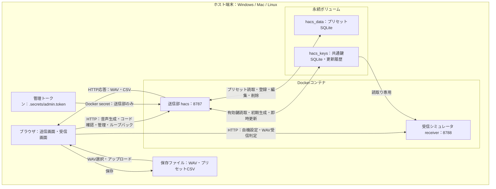
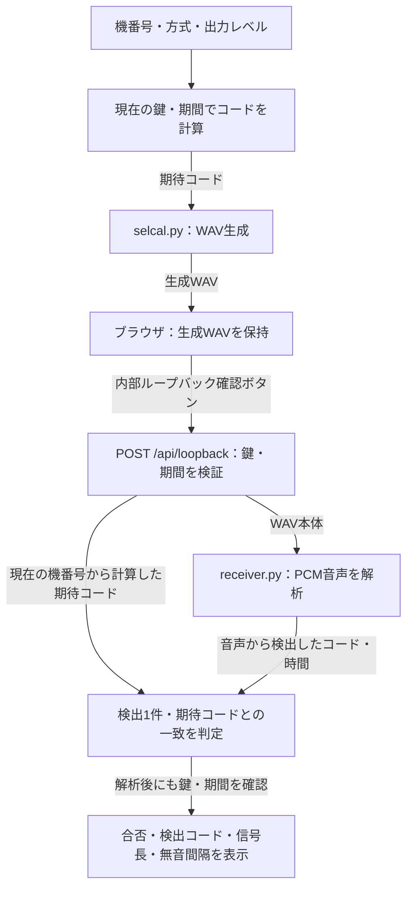
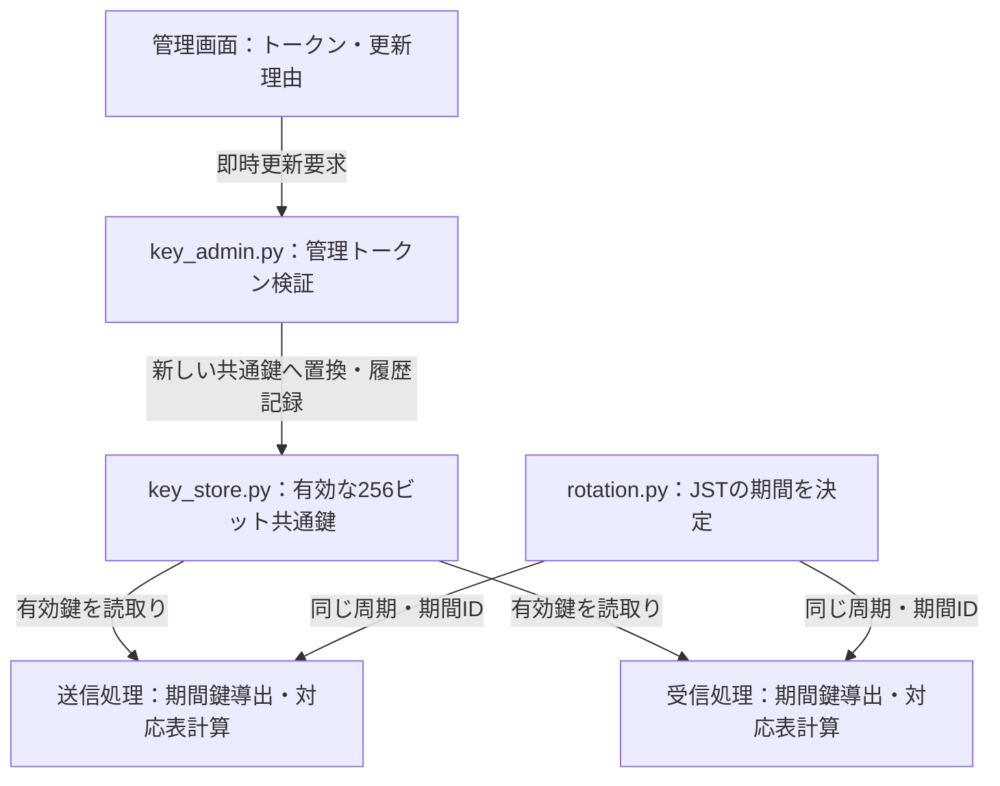

# HACS システム構成

現行実装の送信音声生成、受信シミュレータ、内部ループバック、プリセット、共通鍵管理を示します。無線機インターフェースは保留中です。

## 1. 全体構成

以下は `compose.yaml` と `compose.rotation.yaml` を併用した自動更新・共通鍵管理付きの構成です。

| 要素 | 実装・保存先 | 役割 |
|---|---|---|
| 送信画面 | `index.html` と画面用JavaScript | プリセット選択、機番号・方式・出力レベル指定、WAV再生・保存、内部確認、鍵管理 |
| 送信サービス | `server.py` | HTTP API、生成・変換・一覧出力、内部ループバックの受付 |
| 信号生成 | `selcal.py` | 従来16音／SELCAL 32の2組の信号を48 kHz・16 bit・mono WAVで生成 |
| 機番号変換 | `tail_mapping.py`、`rotation.py` | 4桁機番号とコードの変換、JSTの期間選択、共通鍵による対応表変更 |
| プリセット管理 | `presets.py`、`preset_exports.py` | `/data/presets.sqlite3` に名称・機番号・方式を保存し、現在のコード一覧・CSVを生成 |
| 共通鍵管理 | `key_store.py`、`key_admin.py` | `/keydata/keys.sqlite3` の有効鍵・世代・更新履歴、管理トークンでの即時更新 |
| 受信画面・サービス | `receiver.html`、`receiver_server.py` | 自機番号・方式の設定、アップロードされたWAVの一致判定 |
| 音声解析 | `receiver.py` | PCMの周波数成分、信号長、無音間隔、コード形式を解析 |
| WAV付帯情報 | `wav_context.py` | 鍵付きWAVの期間・鍵識別子を保持し、古い設定による利用を検出 |

送信部と受信部は同じイメージから起動しますが、別のPythonプロセスです。ポート公開先はホストの `127.0.0.1` に限定しています。送信部から受信コンテナへの自動音声転送はなく、受信画面ではブラウザを介してWAVをアップロードします。

通常の `compose.yaml` だけで起動した場合は鍵なし固定変換です。共通鍵ボリュームと管理トークンは、自動更新用Compose設定を併用した場合に追加されます。

## 2. 内部ループバックの構成

保存・再生に使用する同じWAVを送信コンテナ内の受信解析関数へ渡します。別の受信コンテナを起動せずに確認できます。

一致した呼び出しが1件検出された場合に合格とします。異なるコードや無音は不合格です。鍵付きWAVでは付帯情報の一致も確認しますが、コード検出そのものは付帯情報ではなくPCM音声から行います。

設定変更・音声再生成・鍵や期間の更新で画面の確認結果を無効にします。確認結果は送信を強制的に許可・禁止する仕組みにはしていません。WAV再生・保存は利用者が別途操作します。

## 3. 共通鍵・期間の管理

定期更新は毎日、毎週月曜日、毎月1日の **日本時刻00:00** です。定期更新では共通鍵から期間鍵を導出し、機番号とコードの対応関係を変更します。共通鍵自体の漏えい対応は管理画面からの即時置換で行います。各処理は開始時の鍵と期間を固定し、内部ループバックでは解析終了時にも現在値との一致を確認します。

プリセットにはコードや鍵を保存せず、出力時にコードを計算します。CSVには期間・鍵識別子・作成日時等を記載し、保存済みCSVは更新後に再出力します。管理トークンは共通鍵とは別で、受信コンテナには渡しません。

## 4. 実無線機との接続境界

接続対象はメーカーを限定しないHF無線機とします。HACSの共通処理（コード変換・信号生成・内部確認）と、機種ごとの音声・PTTアダプタを分離する設計です。接続可否は各機種の端子、音声帯域、入力レベル、インピーダンス、PTT方式、立ち上がり時間等を確認して判断します。[汎用音声入力・PTTテンプレート](generic-radio-interface.md)として、機種別プロファイル、音声・PTTの共通契約、ドライランを実装しています。ホスト音声・RTS/DTRドライバも実装していますが、接続仕様確定と実機試験は引き続き保留中です。[Ethernet・MIL-STD-1553・シリアル](radio-transport-options.md)も追加検討対象です。

| 経路・機能 | 現在の状態 |
|---|---|
| ブラウザからホスト端末の音声出力へ再生 | 実装済み。出力先と音量はホストOS・ブラウザで設定 |
| ホスト音声出力からHF無線機の音声入力へ接続（メーカー不問） | インターフェース保留中。型番・端子・レベル等の確定が必要 |
| PTT制御・送信開始待ち・送信終了制御 | ホストCLIの汎用音声・RTS/DTR手順を実装。Web連携・実機試験は未実施 |
| RF送信から実受信装置までの相互接続 | 未検証 |
| 受信コンテナによる実RF・マイク連続受信 | 未実装。WAV受信シミュレータのみ |

内部ループバックの確認範囲はデジタル音声生成・解析です。音声端子、無線機、RF経路、実受信装置の動作や、既存航空機に割り当てられたコードとの一致は別途確認します。

## 関連文書

- [起動・自動更新・プリセット・共通鍵管理](automatic-rotation-and-management.md)
- [二方式対応仕様](dual-mode-spec.md)
- [ユーザインターフェース仕様](user-interface-spec.md)
- [共通鍵による変換秘匿仕様](keyed-mapping-spec.md)
- [SELCAL互換性確認](selcal-compatibility.md)

図はGitHubで表示できるMermaid形式です。現行コード・Compose設定に基づく構成であり、Docker・実無線機での検証済み構成を意味するものではありません。
