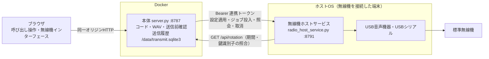
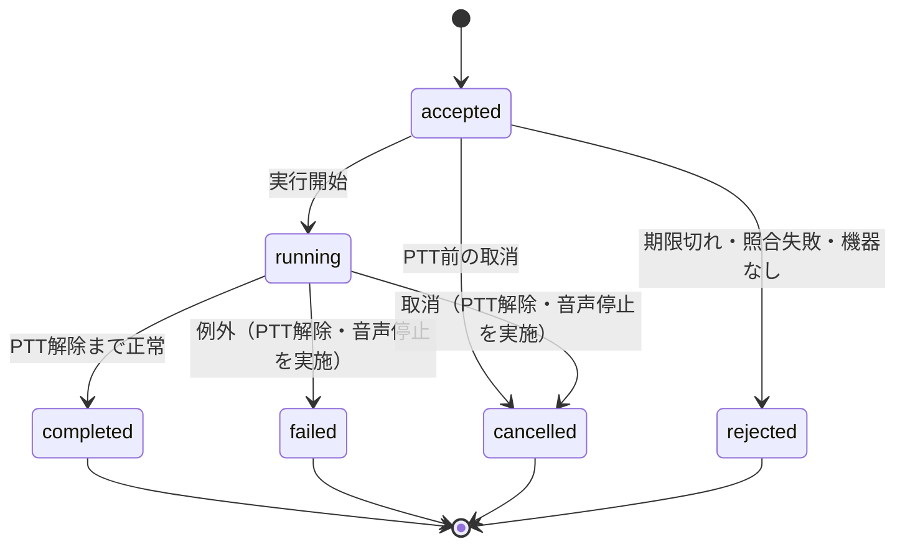
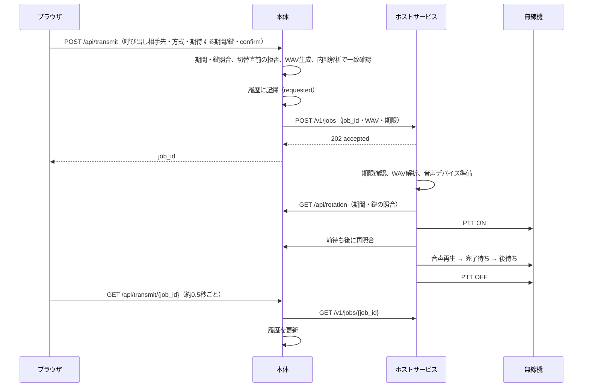

# Web画面とホストサービスの連携設計 v1

作成日：2026-10-14（日本時間）
対象：[引き継ぎ書](developer-handover.md)の優先3（設計）と優先4（実装・模擬試験）
前提：[標準アナログ無線機仕様](standard-analog-radio-spec.md)（アナログ音声入力＋接点PTT）

## 1. 目的と方針

Web画面から、無線機に接続したホスト端末の音声出力とPTTを操作し、呼び出しの送信までを完結させます。

| 方針 | 内容 |
|---|---|
| 権限の一元化 | ブラウザは従来どおり本体（8787）とだけ通信します。コード計算、WAV生成、送信前確認、送信履歴は本体が担当します |
| 機器に近い処理の分離 | USB音声機器とシリアルPTTは、OSに依存するためDockerの外で動かします。ホスト上の常駐プロセス「無線機ホストサービス」（`radio_host_service.py`、既定ポート8791）が担当します |
| 共通鍵を配らない | ホストサービスは共通鍵を持ちません。本体が生成した検証済みWAVと期待コードを受け取り、送信直前に本体の公開状態（`/api/rotation`）と期間・鍵識別子を照合します |
| 実出力の二重許可 | プロファイルの`backend`が`host_audio_serial`であり、かつホストサービスを`--allow-physical-output`付きで起動した場合だけ、実際の音声出力とPTT操作を行います。それ以外はドライラン（実時間で待つ模擬動作）です |
| 失敗時は送信しない | 認証、期限、照合、機器確認のいずれかで失敗した場合や、本体またはホストに到達できない場合は、PTTを操作しません |
| 状態の区別 | 「要求受付」「PTT ON」「音声出力完了」「PTT解除」「ジョブ完了」を別々のイベントとして記録します。相手の受信成功は扱いません（`receiver_acknowledged: false`） |

## 2. 構成



| 経路 | 宛先URL | 設定 |
|---|---|---|
| 本体 → ホストサービス | Docker Desktop（Windows・Mac）：`http://host.docker.internal:8791`。Linux：`host-gateway`経由。Dockerを使わない場合：`http://127.0.0.1:8791` | `HACS_RADIO_HOST_URL` |
| ホストサービス → 本体 | `http://127.0.0.1:8787`（公開ポート） | `HACS_MAIN_URL` |

ホストサービスの待受アドレスは既定で`127.0.0.1`です。Linux上のDockerから接続する場合は、Dockerブリッジのゲートウェイアドレス（例：`172.17.0.1`）を`--bind`で指定します。LAN上の他端末からの接続は想定しません。

## 3. 認証

| 項目 | 内容 |
|---|---|
| 連携トークン | `.secrets/radio-host.token`。`generate_key.py --output .secrets/radio-host.token`で作成する64桁の16進数 |
| 本体側 | Docker secretとして読み込み、`HACS_RADIO_HOST_TOKEN_FILE`で指定 |
| ホストサービス側 | 同じファイルを`--token-file`で指定 |
| 照合 | `Authorization: Bearer <token>`の定数時間比較。不一致・欠落は401。トークンをログや応答に出力しない |
| 分離 | 管理トークン（鍵更新用）、コード変換用の共通鍵とは別のファイル・用途とする |

本体のWeb APIは、従来どおり`127.0.0.1`への公開、同一オリジン（`Origin`）の照合、`application/json`の必須化でブラウザ外部からの書き換えを防ぎます。送信要求には、さらに`confirm: true`を必須とします。利用者ごとの認証・権限は、LAN公開を行う段階で別途設計します（引き継ぎ書の追加残件）。

## 4. ホストサービスAPI（v1）

すべて連携トークンが必要です。応答はJSONです。

| メソッド・パス | 内容 |
|---|---|
| `GET /v1/status` | サービス状態（`idle`／`busy`）、実出力の許可、適用中プロファイルの要約、機器確認の結果、直近ジョブ |
| `GET /v1/devices` | 音声出力機器とシリアルポートの一覧。依存ライブラリがない場合は`available: false`と理由 |
| `POST /v1/profile` | プロファイルを検証して適用（＝接続）。機器の存在を確認するが、ポートを開いたりPTTを操作したりしない。送信中は409 |
| `DELETE /v1/profile` | 適用を解除（＝切断）。送信中は409 |
| `POST /v1/jobs` | 送信ジョブを投入。受付後は202を返し、別スレッドで実行 |
| `GET /v1/jobs/{job_id}` | ジョブの状態とイベント列 |
| `POST /v1/jobs/{job_id}/cancel` | 取消。PTT前なら送信せず終了、PTT後なら音声停止とPTT解除を即時に実行 |

### ジョブの投入内容

| 項目 | 内容 |
|---|---|
| `job_id` | 本体が発行するUUID。同じIDと同じ内容の再投入は既存ジョブを返し、二重に送信しない。同じIDで内容が異なる場合は409 |
| `tail_number`、`mode`、`code` | 記録と照合用。`code`はWAVの解析結果と一致しなければ拒否 |
| `period_id`、`key_id` | 本体が生成した時点の期間・鍵識別子（鍵なしでは空文字） |
| `expires_at` | UNIX時刻。開始時点で期限を過ぎていれば拒否。本体は投入時刻＋15秒を設定 |
| `wav_base64` | 本体が生成・内部確認したWAV（48 kHz・16 bit・mono、2 MB以下） |

### ジョブの状態



イベントは`audio_prepare`、`ptt_on`、`audio_start`、`audio_complete`、`ptt_off`、`audio_stop`などを、UTC時刻と開始からの経過秒で記録します。実出力のジョブかどうかは`physical_output`で示します。ジョブはホストのメモリに直近100件を保持し、サービスを再起動すると失われます。

## 5. 送信の順序



本体は、期間切替までの残り時間が「前待ち＋2.2秒＋後待ち＋期限15秒」に満たない場合、ジョブを作りません。ホストサービスは送信直前とPTT ON後に照合し、本体に到達できない場合や期間・鍵識別子が変わった場合は送信しないか、即座にPTTを解除します。

## 6. 排他と異常時の扱い

| 事象 | 扱い |
|---|---|
| 同時に2件の送信 | ホストサービスは1件のみ実行し、他は409。本体も実行中のジョブがあれば新規要求を拒否 |
| 送信中の設定変更 | ホストサービスの設定適用・解除は409。本体のWeb設定保存は可能だが、ホストへの適用は送信後に行う |
| 本体 → ホストの通信失敗 | 投入失敗は送信されていない扱い（`submit_failed`）。照会失敗は`unknown`として表示し、ホストの状態が取得できたら更新 |
| ホストサービスの再起動 | 実行中ジョブは失われ、本体では`unknown`。PTTは、プロセス終了とUSBシリアルの解放、および接続部のハードウェア上限（6秒）で解除される |
| 取消 | PTT前：送信せず`cancelled`。PTT後：音声停止とPTT解除をただちに実施し`cancelled`。解除後に音声ドライバが停止を完了するまで待つことがある |
| 時間上限 | ソフトウェアのPTT上限（既定5秒）と、接続部のハードウェア上限（6秒）の二重で制限 |

## 7. Web画面

| タブ | 追加する表示・操作 |
|---|---|
| 呼び出し操作 | 「無線機から送信」ボタン。ホストが待機中で、生成した音声が現在の入力と一致し、内部ループバックに合格している場合だけ有効。確認ダイアログの後に送信。送信状態（受付・送信中・完了・失敗・取消・不明）とPTT・音声イベントを表示。送信中は「送信を中止」ボタン |
| 無線機インターフェース | ホストサービスの状態（未設定・到達不可・未接続・待機・送信中）、実出力の許可、検出した機器一覧、「ホストへ設定を適用（接続）」「適用解除（切断）」 |
| 操作・更新履歴 | サーバ側の送信履歴（ジョブID、時刻、呼び出し相手先、コード、方式、実出力の有無、結果） |

取得できない状態は「不明」と表示し、推測で「完了」としません。

## 8. 本体のAPI追加

| メソッド・パス | 内容 |
|---|---|
| `GET /api/radio-host` | ホストサービスの設定有無と状態（到達不可も含む） |
| `GET /api/radio-host/devices` | ホストの機器一覧（中継） |
| `POST /api/radio-host/apply` | 保存済みの無線機設定をホストに適用。`{"action":"apply"}`または`{"action":"release"}` |
| `POST /api/transmit` | `{"tail_number","mode","period_id","key_id","confirm":true}`。送信ジョブを作成 |
| `GET /api/transmit/{job_id}` | ジョブ状態（ホストから取得し履歴を更新） |
| `POST /api/transmit/{job_id}/cancel` | 取消 |
| `GET /api/transmit/history` | 送信履歴（新しい順、最大200件） |

送信履歴は`/data/transmit.sqlite3`に保存し、最新1000件を保持します。WAV本体と連携トークンは保存しません。

## 9. 起動構成

```sh
python3 generate_key.py --output .secrets/radio-host.token
# ホスト（無線機を接続した端末）
python3 radio_host_service.py --token-file .secrets/radio-host.token
# 本体（Docker）
docker compose -f compose.yaml -f compose.radio-host.yaml up -d --build
```

実出力を行う場合だけ、ホストサービスを`--allow-physical-output`付きで起動します。鍵付き構成では、`compose.rotation.yaml`などと組み合わせます。

## 10. 実装と試験の範囲

| 項目 | 優先4での扱い |
|---|---|
| ホストサービス（API、認証、ジョブ、排他、取消、照合、機器確認） | 実装済み。模擬ドライバで単体試験14件（`test_radio_host_service.py`） |
| 本体の送信API・履歴・画面 | 実装済み。ドライランのホストサービスと結合試験（`test_transmit.py`、`test_transmit_ui.js`、`e2e_check.py --transmit`） |
| 実機（USB音声・USBシリアル）での動作 | 未実施。[標準仕様](standard-analog-radio-spec.md)の試験S2〜S4で確認 |
| 複数利用者の認証・権限、LAN公開 | 対象外 |

### 2026-10-14の試験結果

- 単体・結合試験：Python 89件、Node 6本が合格。
- イメージ相当構成の本体と、別プロセスのホストサービス（ドライラン）：`e2e_check.py --transmit`で通常構成39件、共有鍵構成53件が合格。ホストサービスのログに連携トークンが出力されないことも確認。
- ヘッドレスChromium（PC・iPad・スマートフォン幅）：設定適用、機器一覧、ループバック合格前は送信不可、確認ダイアログ、送信完了とPTTイベント表示、送信中の中止、送信履歴の表示で30項目が合格。
- 依存ライブラリ（sounddevice・pyserial）を入れていない環境では、機器一覧に「取得できません」と理由を表示することを確認。実機の音声機器・シリアルポートでの動作は未確認。
